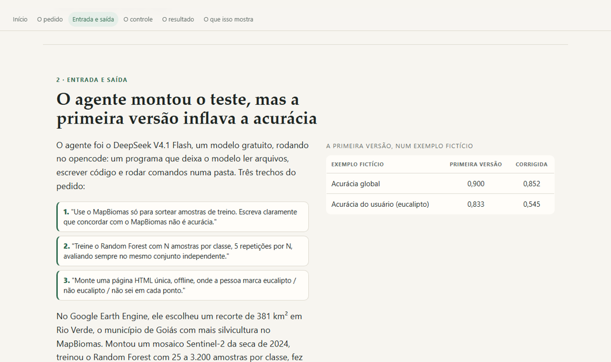

# Do formulário ao mapa conferido — eucalipto em Goiás

**Quantas amostras de treino usar no Random Forest e como conferir um mapa de eucalipto (Rio Verde, GO), com página de conferência cega e teste de pré-triagem por IA.**

Encontro individual do Estágio Docência · LAPIG/UFG · 03/11/2026.

- **Ver a página:** <https://victorgit10.github.io/bianca-eucalipto/>
- **Repositório:** <https://github.com/VictorGit10/bianca-eucalipto>



## O que tem aqui

- **`index.html`**: a página do encontro. Começa pela resposta ao formulário e mostra o que a IA generativa fez com ela: a entrada, a primeira saída, os controles, o resultado e o que isso mostra. Funciona offline (imagens embutidas).
- **O pacote** (`codigo/`, `dados/`, `figuras/`, `RELATORIO.md`, `REFERENCIAS.md`): o trabalho completo, executado de ponta a ponta. Todos os números saem dos scripts. Instruções abaixo.
- **`CLAUDE.md` e `AGENTS.md`**: o contexto para a IA que for continuar o trabalho.
- **`docs/revisoes/`**: o caminho do trabalho, para quem quiser auditar: o formulário (`CONTEXTO.md`), o pedido dado ao agente (`PEDIDO.md`, `REGRAS-COMUNS.md`), as correções pedidas (`CORRECOES*.md`) e a conferência independente de outro modelo (`CONFERENCIA-MINIMAX.md`).

## Como foi feito

1. O formulário virou um pedido escrito para um agente de IA (DeepSeek V4.1 Flash, no opencode), com regras: dados públicos, todo número saindo de script, controle em cada conclusão, referência só com DOI conferido.
2. O agente executou tudo. Claude conferiu (testes, números, DOIs) e pediu correções.
3. Outros modelos revisaram sem poder alterar nada (MiniMax M3.1 e Gemini Argon). Cada afirmação deles foi conferida no código antes de corrigir.
4. A página foi redigida pelo Gemini 3.8 a partir de um briefing com os fatos conferidos, e revisada.

Os arquivos brutos maiores (mosaicos, ZIPs baixados) não estão no repositório: os scripts baixam de novo. O projeto do Earth Engine aparece como `SEU-PROJETO-EARTH-ENGINE`: troque pelo seu.

## Continuar com uma IA

O repositório foi organizado para um assistente ler. Cole o link no Claude, ChatGPT, Gemini ou Codex e peça, por exemplo: "Explique a estrutura deste repositório e como rodar o pacote", ou "Adapte o procedimento para os meus dados". O `CLAUDE.md` traz o contexto, as armadilhas e a ordem dos scripts.

## Licença

Texto, página e figuras: CC BY 4.0. Código em `codigo/`: MIT. Detalhes em `LICENSE`.

---

# O pacote

## Mapa de eucalipto com Random Forest — teste em Rio Verde (GO)

Este repositório é o resultado de um teste pequeno e real: **quantas amostras de treino usar** e
**como conferir se o mapa está bom**, usando um recorte de 381 km² em Rio Verde (GO), Sentinel-2 de 2024
e o Random Forest que você já usa.

Tudo foi executado: os números do `RELATORIO.md` saíram dos scripts desta pasta, não de estimativa.

## O que está pronto para usar

| Arquivo | Para quê |
|---|---|
| `RELATORIO.md` | O resultado completo: a curva de aprendizado, o que ela mostra, os limites e onde a IA ajuda. **Comece por aqui.** |
| `conferencia/index.html` | A ferramenta de conferência. Abra no navegador, marque os 108 pontos, exporte o CSV. Funciona offline e é cega (não tem a classe do mapa). |
| `dados/chave/pontos_chave.csv` | A chave `id` → estrato/classe do mapa, guardada em pasta separada. **Não abra antes de marcar** — abrir perde a cegueira. |
| `figuras/curva_aprendizado.png` | F1 do eucalipto × número de amostras, com e sem separação espacial. |
| `figuras/mapa_area.png` | Sentinel-2, MapBiomas e o mapa do Random Forest, lado a lado. |
| `codigo/` | Tudo que gerou os números, na ordem abaixo. |
| `REFERENCIAS.md` | 10 referências com DOI conferido no Crossref. |

## Como conferir o mapa (a parte que só você pode fazer)

1. Abra `conferencia/index.html` (duplo clique; não precisa de internet).
2. Para cada um dos 108 pontos aparecem duas imagens: detalhe de 700 m e contexto de 2 km.
   Marque **eucalipto** (tecla 1), **outra cobertura** (2) ou **não dá para saber** (3).
3. **Regra de rotulagem:** o **quadrado vermelho** no centro da imagem marca o pixel de 20 m que você está
   classificando (tecla **m** ou o botão sob as imagens mostram/ocultam). Classifique pelo que ocupa a **maior
   parte desse pixel**, não pelo que está em volta. Se o pixel cai em transição de talhão e você não consegue
   decidir, use **"não dá para saber"** — não force um palpite.
4. **A conferência é cega de verdade:** a página não mostra *e* não guarda a classe que o mapa previu. O HTML tem
   só `id`, `lon`, `lat` e as imagens; o `conferencia/pontos.csv` tem só `id`, `lon`, `lat`; e o CSV exportado tem
   `id`, `lon`, `lat`, `marcacao`. A chave com a classe do mapa fica em `dados/chave/pontos_chave.csv` e só o script de
   cálculo lê. Os ids também são embaralhados, então o número do ponto não revela o estrato.
   **Não abra `dados/chave/pontos_chave.csv` antes de terminar de marcar.**
5. Suas marcações ficam salvas no navegador. Pode fechar e continuar depois no mesmo navegador.
6. Ao terminar, clique em **Exportar CSV** e salve como `conferencia/marcacoes.csv`.
7. Calcule o resultado:

```
python codigo/06_acuracia.py conferencia/marcacoes.csv
```

A saída traz: matriz de confusão, acurácia global (com IC95), acurácia do usuário e do produtor e
**área de eucalipto ajustada com intervalo de confiança**. É esse último número que responde
"o mapa está satisfatório?" — não a acurácia global.

> **A acurácia global daqui é binária** (eucalipto × não eucalipto). Não a compare com a acurácia de 5 classes da
> curva de aprendizado: são perguntas diferentes.

> **Ressalva importante:** a imagem de conferência é Sentinel-2 de 10 m, **a mesma fonte usada no mapa**. Marcar
> nela mede a concordância com o que se vê nessa imagem, não a verdade de campo. Nos pontos duvidosos, abra o link
> do Google Maps (alta resolução) e, se possível, compare outra data: plantio jovem e talhão recém-colhido se
> parecem com pastagem.

> Enquanto você não marcar, o `06` roda com um CSV **fictício** (`marcacoes_FICTICIO.csv`) só para você ver
> o formato da saída. Os números dele não descrevem o mapa. Há também
> `marcacoes_FICTICIO_estrato_vazio.csv`, que serve para testar o caso em que um estrato inteiro fica sem marcação.

> **Por que 44 dos 108 pontos caem em borda de talhão:** os pontos são sorteados em todos os pixels do estrato,
> sem filtro. "Borda" aqui é vizinhança de 3 × 3 pixels do mapa (60 m × 60 m) com mais de uma classe. Excluir a
> borda daria probabilidade zero justamente aos pixels onde o mapa mais erra — e o controle do `07` mostra que
> isso faz o intervalo de confiança da área cobrir a verdade em **0%** das simulações (num cenário sintético em que
> o filtro elimina todos os erros do estrato). É por isso que "não dá para saber" existe: um ponto de borda
> indecidível é informação, não erro de amostragem.

## Como rodar do zero

Requisitos: Python 3.10+ com `earthengine-api` autenticado (`ee.Initialize(project='SEU-PROJETO-EARTH-ENGINE')`),
`numpy`, `pandas`, `scikit-learn`, `matplotlib`, `rasterio`, `scipy`, `pillow`, `pyproj`, `requests`.

```
python codigo/01_escolher_area.py       # escolhe o recorte (usa MapBiomas + municípios)
python codigo/02_baixar_imagens.py      # baixa mosaico Sentinel-2 e rótulos (~63 MB)
python codigo/03_curva_aprendizado.py   # a curva de aprendizado (~4 min)
python codigo/04_mapa.py                # mapa final + figura
python codigo/05_desenho_validacao.py   # sorteio dos 108 pontos + página HTML
python codigo/06_acuracia.py            # acurácias e área ajustada (precisa do CSV marcado)
python codigo/07_controle.py            # testes de controle (o código está certo?)
python codigo/08_resumo.py              # tabela final com todos os números
python codigo/09_plano_goias.py         # números para o mapa estadual (Goiás)
python codigo/test_olofsson.py          # testa o estimador contra o exemplo publicado
python codigo/verificar_referencias.py  # confere os DOIs no Crossref
```

Cada script é independente e pode ser rodado sozinho, desde que o anterior tenha gerado seus arquivos.
`--forcar` refaz o download; `--se 0.03` muda o tamanho da amostra de validação; `--n 800` muda o
treino do mapa final.

## Para Goiás (o passo seguinte)

O recorte de Rio Verde mostra **como** fazer; o estado é outro problema. A seção 14 do `RELATORIO.md` traz o
plano com números (`python codigo/09_plano_goias.py`):

- eucalipto é só **0,40%** da área de Goiás (1.392 km²), então alocação proporcional dá **1 ponto** para a classe
  rara — é preciso piso;
- **275 pontos** de validação no estado (100 no eucalipto) para SE 0,03;
- repetir a curva de aprendizado em **três regiões** com contextos diferentes (Rio Verde, Niquelândia, Catalão)
  antes de treinar o mapa estadual, e sortear treino **por região**.

## O que você provavelmente vai querer mudar

- **O agrupamento de classes** (`codigo/common.py`, dicionário `GRUPOS`): hoje são 5 grupos.
  Se você precisa separar soja de cana, ou cerrado de floresta, mude ali e rode de novo.
- **O recorte**: `01_escolher_area.py` escolhe Rio Verde automaticamente. Para fixar outro lugar,
  edite o dicionário `dados/recorte.json` (centro e bbox).
- **As datas do mosaico** (`common.py`, `SECA` e `CHUVA`).
- **O erro tolerado na validação**: `--se 0.03` → 191 pontos em vez de 108.

## Cuidados

- Os rótulos de treino vêm do **MapBiomas**. Concordar com ele **não é acurácia**: é a mesma fonte que
  gerou o mapa. A validação de verdade é a sua marcação nos 108 pontos.
- O mapa é de **20 m**, enquanto o MapBiomas é de 30 m. Isso, sozinho, cria erro nas bordas dos talhões.
- A área ajustada só é válida se **todos os estratos tiverem pontos marcados**. Se você deixar muitos
  pontos como "não sei", o script avisa e o resultado fica mais incerto. Como os pontos de borda fazem parte da
  amostra, é normal ter "não sei" — o `06` imprime as duas políticas (excluir ou contar como erro) para você ver
  o quanto isso muda o resultado.
- Nada aqui usa dado pessoal, conta ou credencial além do Earth Engine já autenticado nesta máquina,
  e os arquivos baixados somam 62,7 MB no disco (tamanho local, não tráfego de rede).

## Próximo passo sugerido

Marque os 108 pontos e rode o `06`. Se o erro estiver concentrado entre **floresta e eucalipto**
(veja a matriz de confusão), o problema é de feição, não de quantidade de amostra: vale testar
série temporal de NDVI por talhão antes de coletar mais amostras.

_Última atualização: 31/10/2026 — correções de método após conferência externa (ver seção 14 do `RELATORIO.md`)._

